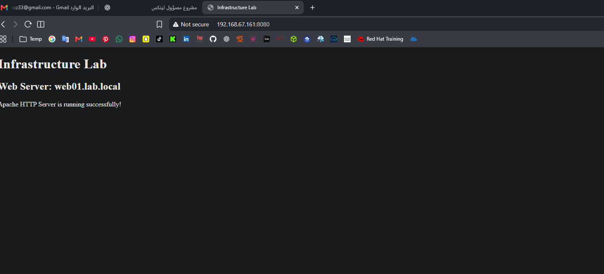
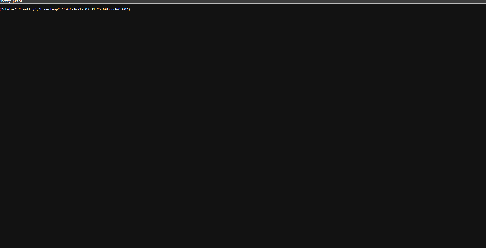
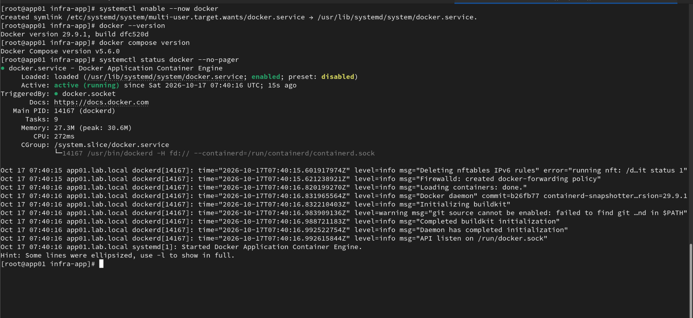
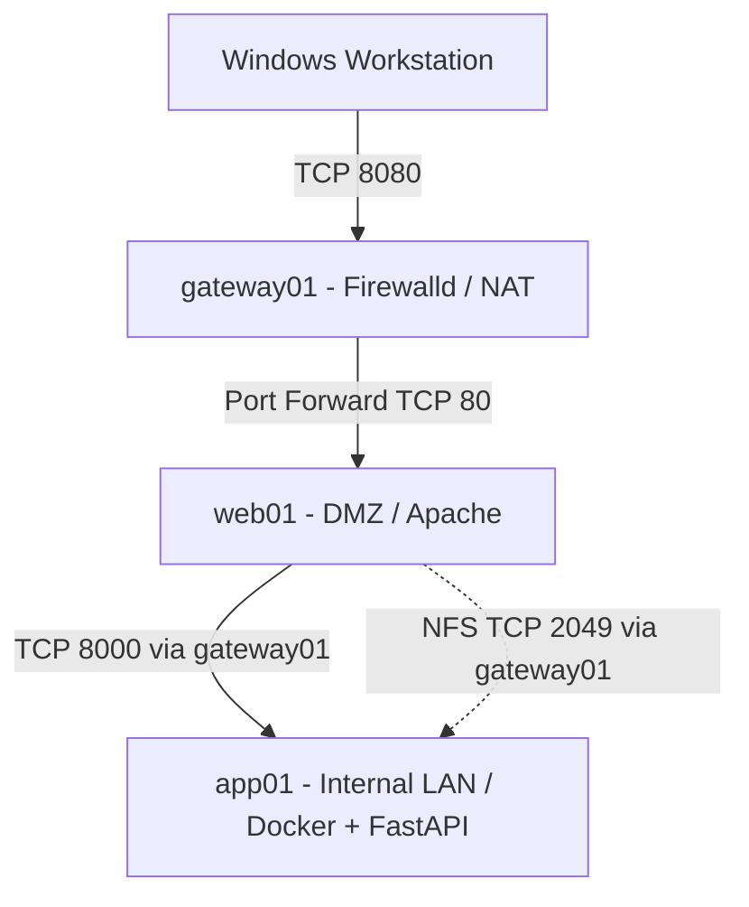

# RHCSA Infrastructure Lab

A hands-on Red Hat Enterprise Linux 9 infrastructure lab built with VMware Workstation to demonstrate practical Linux system administration skills aligned with RHCSA objectives.

## Project Overview

Designed and configured a three-server Linux infrastructure featuring network segmentation, secure service communication, storage management, role-based access control, containerized application deployment, and automated system maintenance.

## Infrastructure

| Server | Role | Network |
|---|---|---|
| gateway01 | Routing, NAT, and Firewalld | External, DMZ, Internal |
| web01 | Apache Reverse Proxy and AutoFS Client | DMZ — 192.168.10.10 |
| app01 | FastAPI, Docker, NFS Server, and LVM Storage | Internal — 192.168.20.10 |

## RHCSA Skills Demonstrated

- **Identity & Access Management:** Local users, groups, role-based sudo permissions, password aging, and SETGID shared directories.
- **Storage Management:** LVM, XFS filesystems, logical volume expansion, and persistent mounts.
- **Network Configuration:** NetworkManager, static IP addressing, routing, and NAT.
- **Security:** SELinux, SSH configuration, Firewalld zones, and network access policies.
- **Network File Sharing:** NFS exports and AutoFS client configuration.
- **Package Management:** DNF repositories and RPM package administration.
- **Automation:** Bash scripting, cron jobs, and systemd timers.
- **Service Management:** systemd services, boot persistence, and troubleshooting with journalctl.

## Identity & Access Management

Implemented role-based access control on the RHEL 9 application server (`app01`) using Linux groups, sudoers policies, and filesystem permissions.

### Administrative Roles

| Role | Group | Permissions |
|---|---|---|
| System Administrator | sysadmins | Full sudo administration |
| Application Operator | developers | Restart the `infra-api` Docker container through a restricted script |
| Web Administrator | webadmins | Restart the Apache HTTP service |

### Security Controls

- Configured dedicated administrative groups and restricted sudo privileges.
- Implemented password aging with a 90-day maximum, 7-day minimum, and 14-day warning period.
- Configured `/srv/developers` with permission mode `2770` and SETGID group inheritance.
- Created a root-owned script for controlled Docker container restarts.
- Validated sudoers syntax using `visudo -c`.
- Verified successful Docker container restart using a restricted user account.

### Documentation

- [User and Group Administration](security/user-administration.md)
- [Sudo Access Control](security/sudo-access-control.md)
- [Shared Directory Permissions and SETGID](security/shared-directory-permissions.md)

## Additional Technologies

- VMware Workstation
- Docker and Docker Compose
- Apache HTTP Server
- Python FastAPI

## Validation

The infrastructure was tested to verify:

- Successful network initialization after reboot.
- Active firewall rules and IP forwarding.
- Healthy application communication between the DMZ and internal network.
- Functional NFS and AutoFS mounts.
- Successful systemd service and timer execution.
- No failed systemd units during the previous infrastructure validation.
- Correct user and group memberships.
- Restricted sudo permissions and successful sudoers syntax validation.
- Successful Docker container restart by the authorized application operator.
- Shared directory creation and SETGID group inheritance.

## Project Outcome

Deployed and validated a segmented RHEL 9 infrastructure lab demonstrating practical Linux system administration skills, including networking, storage, access control, automation, and containerized application deployment.

The project also demonstrates troubleshooting of real service conflicts, including identifying a Docker port binding conflict and retaining the existing containerized application deployment.

## Project Screenshots

### Web Server

### API Health Check

### Docker Container

## Configuration Files

- [Docker & FastAPI](docker/)
- [Apache Reverse Proxy](apache/)
- [Network Configuration](network/)
- [NFS & AutoFS](storage/)
- [SELinux and Access Control](security/)
- [System Automation](automation/)
- [DNF Repository Management](packages/)

## Network Architecture

