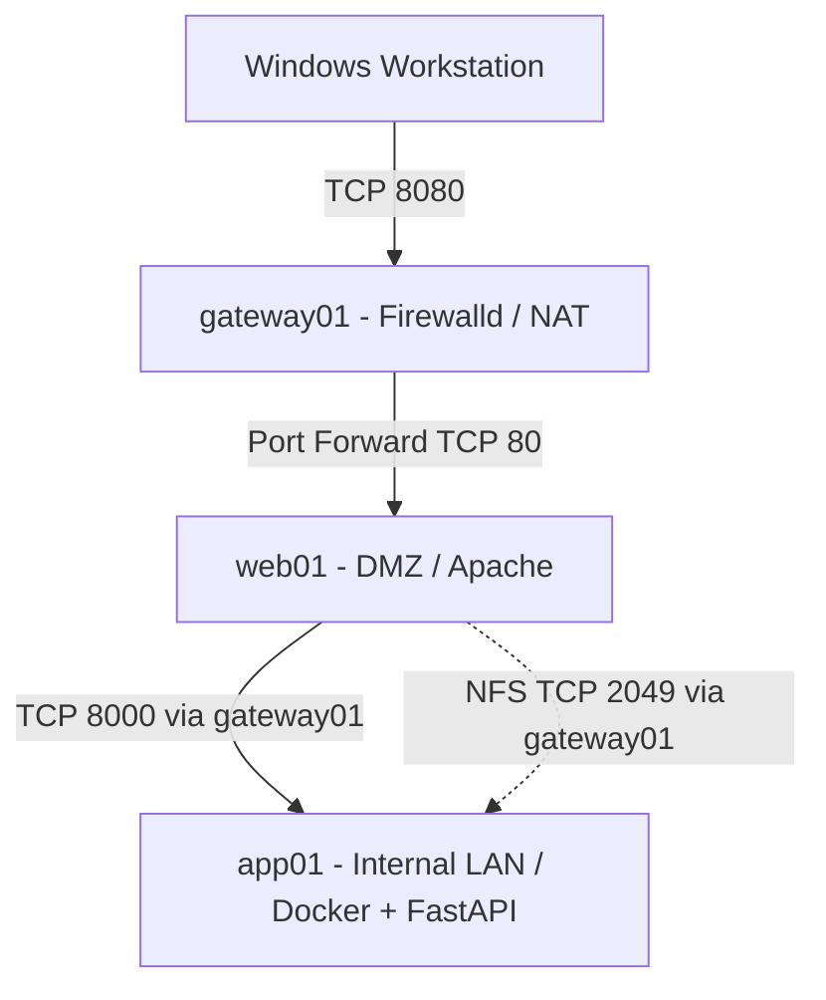

# RHCSA Infrastructure Lab

A hands-on Red Hat Enterprise Linux 9 infrastructure lab built with VMware Workstation to demonstrate practical Linux system administration skills aligned with RHCSA objectives.

## Project Overview

Designed and configured a three-server Linux infrastructure featuring network segmentation, secure service communication, storage management, user administration, and automated system maintenance.

## Infrastructure

| Server | Role | Network |
|---|---|---|
| gateway01 | Routing, NAT, and Firewalld | External, DMZ, Internal |
| web01 | Apache Reverse Proxy and AutoFS Client | DMZ — 192.168.10.10 |
| app01 | FastAPI, Docker, NFS Server, and LVM Storage | Internal — 192.168.20.10 |

## RHCSA Skills Demonstrated

- **User Administration:** Users, groups, sudo privileges, and file permissions.
- **Storage Management:** LVM, XFS filesystems, logical volume expansion, and persistent mounts.
- **Network Configuration:** NetworkManager, static IP addressing, routing, and NAT.
- **Security:** SELinux, SSH configuration, Firewalld zones, and network access policies.
- **Network File Sharing:** NFS exports and AutoFS client configuration.
- **Package Management:** DNF repositories and RPM package administration.
- **Automation:** Bash scripting, cron jobs, and systemd timers.
- **Service Management:** systemd services, boot persistence, and troubleshooting with journalctl.

## Additional Technologies

- VMware Workstation
- Docker and Docker Compose
- Apache HTTP Server
- Python FastAPI

## Validation

The infrastructure was tested to verify:

- Successful network initialization after reboot.
- Active firewall rules and IP forwarding.
- Healthy application communication between the DMZ and internal network.
- Functional NFS and AutoFS mounts.
- Successful systemd service and timer execution.
- No failed systemd units during final validation.

## Project Outcome

Successfully deployed and validated a segmented RHEL 9 infrastructure lab demonstrating practical RHCSA-level Linux administration skills and additional exposure to containerized application deployment.

## Project Screenshots

### Web Server

### API Health Check

### Docker Container

## Configuration Files

- [Docker & FastAPI](docker/)
- [Apache Reverse Proxy](apache/)
- [Network Configuration](network/)
- [NFS & AutoFS](storage/)
- [SELinux Security](security/)
- [System Automation](automation/)
- [DNF Repository Management](packages/)

## Network Architecture

